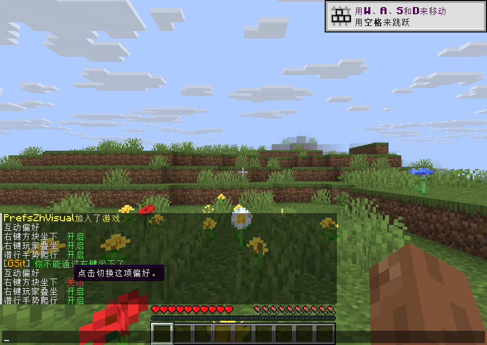

# 命令、权限与配置

## 玩家和控制台命令

| 命令 | 别名 | 行为 | Pumpkin 权限 |
| --- | --- | --- | --- |
| `/sit` | `/gsit`、`/pumpgsit` | 坐在脚下方块上 | `PumpGsit:sit` |
| `/sit help` | 同 `/sit` | 查看命令帮助 | `PumpGsit:command` |
| `/sit toggle [on\|off]` | 同 `/sit` | 设置右键方块坐下的偏好 | `PumpGsit:sittoggle` |
| `/sit playertoggle [on\|off]` | 同 `/sit` | 设置参与叠坐的偏好 | `PumpGsit:playersittoggle` |
| `/lay` | `/glay`、`/layback`、`/glayback` | 仰卧 | `PumpGsit:lay` |
| `/legsup` | `/glegsup` | 仰卧翘腿 | `PumpGsit:legsup` |
| `/bellyflop` | `/gbellyflop` | 俯卧 | `PumpGsit:bellyflop` |
| `/spin` | `/gspin` | 原地旋转 | `PumpGsit:spin` |
| `/crawl` | `/gcrawl` | 进入可移动的爬行姿势 | `PumpGsit:crawl` |
| `/crawl toggle [on\|off]` | 同 `/crawl` | 设置潜行触发爬行的偏好 | `PumpGsit:crawltoggle` |
| `/gsitprefs` | — | 查看自己的三项偏好 | `PumpGsit:prefs` |
| `/gsitrl` | `/gsitreload`、`/pumpgsitreload` | 重载插件配置 | `PumpGsit:reload` |

再次执行同一动作命令可起身。默认也可以按潜行键。进入另一种姿势前请先起身。`/sit`、`/crawl` 及其子命令都需要共用的 `PumpGsit:command`，动作和偏好子命令还会检查表中的权限。

三条偏好命令用 `on` 开启或用 `off` 关闭，开关值忽略大小写。省略开关或输入未知值会反转当前偏好。识别开关后忽略多余参数。偏好子命令因玩法开关或权限不可用时，玩家输入会按基础动作命令处理。

控制台可在 `on` 或 `off` 前填目标，例如 `sit toggle 11111111-1111-4111-8111-111111111111 off`。玩家名可用于在线玩家，也可用于能从 OP、白名单或封禁名单唯一找到的离线玩家。其余情况请用原 UUID。

| 互动 | 条件 |
| --- | --- |
| 右键方块坐下 | 需 `PumpGsit:sitclick` 和本人偏好开启。默认空主手右击允许的方块顶面，例如下半台阶。 |
| 右键玩家叠坐 | 点击者需 `PumpGsit:playersit`。点击者和顶层玩家都要同意叠坐，默认需要空主手。 |
| 潜行触发爬行 | 需 `PumpGsit:crawlsneak` 和本人偏好开启。默认在一格高的通道前潜行触发，双击潜行可在配置中开启。 |

## 互动偏好面板

玩家输入 `/gsitprefs` 查看自己的三项互动偏好。按 `T` 打开聊天，点击有切换提示的条目即可执行对应的 `on` 或 `off` 命令。再次输入 `/gsitprefs` 查看新值。玩法开关关闭或缺少该项权限时，对应条目只读。缺少 `PumpGsit:command` 时三项都只读。

控制台或 RCON 可输入 `gsitprefs 11111111-1111-4111-8111-111111111111` 查看该玩家当前的三项设置，也可使用能唯一匹配的玩家名。查询不会写入玩家偏好，适合在切服前后核对同一个 UUID。

## 权限映射

权限前缀区分大小写，请使用 `PumpGsit:`。例如 Bukkit 的 `GSit.PlayerSitToggle` 对应 `PumpGsit:playersittoggle`。从 Bukkit 迁移时，请按两端对应的节点重新设置玩家和权限组，保留原规则的允许或拒绝。[宿主插件命名空间](https://github.com/Pumpkin-MC/Pumpkin/blob/9b4c00eab828504d73d3da4e449a0669e13a242b/crates/pumpkin-core/src/plugin/api/context.rs#L274-L286)

玩法命令、互动和偏好面板默认向普通玩家开放。下列管理和组权限默认授予 OP 2 级及以上。

| 节点 | 作用 |
| --- | --- |
| `PumpGsit:reload` | 执行配置重载 |
| `PumpGsit:kick.sit`、`PumpGsit:kick.pose` | 当 `same_block_rest = false`，可让在目标方块坐下或摆姿势的玩家起身 |
| `PumpGsit:bypass.world`、`PumpGsit:bypass.command` | 分别绕过世界名单和就座期间的命令黑名单 |
| `PumpGsit:sit.*`、`PumpGsit:playersit.*`、`PumpGsit:crawl.*`、`PumpGsit:pose.*` | 对应动作组的子权限 |
| `PumpGsit:kick.*`、`PumpGsit:bypass.*` | 对应让位和绕过限制的子权限 |
| `PumpGsit:*` | 包含上述六组权限，以及 `reload` 和 `prefs` |

Bukkit 的 `GSit.ByPass.Region` 和 `GSit.Update` 在 Pumpkin 版没有对应节点。[功能与部署范围](构建与验证.md#已知差异与部署范围)

Tab 补全来自 Pumpkin 的命令树。`/gsitrl` 立即应用玩法开关，`playertoggle` 和爬行 `toggle` 的补全分支在重新加载插件或重启后更新。能看到补全的玩家仍须通过执行时的权限检查。

## TOML 设置

编辑 `plugins/data/PumpGsit/config.toml`，在控制台执行 `gsitrl`。重载成功后，正在进行的动作会结束，后续操作使用新设置。配置、语言文件或数据库校验失败时，检查控制台日志，插件会继续使用之前的设置。修改宿主 `pumpkin.toml` 中的插件加载权限需要重启服务端。

从 Bukkit 迁移时请手动填写对应 TOML 键。原版玩法键位于 `Options` 下，语言键位于 `Lang` 下。[默认 TOML](../assets/config.toml) · [迁移与回滚](存储.md)

| 原版 YAML 项 | 新 TOML 项 | 默认及作用 |
| --- | --- | --- |
| `Lang.lang`、`Lang.client-lang` | `language`、`client_language` | `"en_us"`、`true`。控制台用配置语言，玩家优先用客户端语言。后文说明如何修改语言文件。 |
| `get-up-damage`、`get-up-sneak`、`get-up-break` | `get_up_damage`、`get_up_sneak`、`get_up_break` | `false`、`true`、`true`。分别控制受伤、潜行和支撑方块消失时起身。爬行有独立的潜行开关。 |
| `get-up-return` | `get_up_return` | `false`。默认返回座面，开启则返回入座前的位置。保持在线时，第一步有效位移后校正位置。断线时在存档前校正。[客户端复查](客户端验证.md#坐下叠坐和重连) |
| `allow-unsafe`、`same-block-rest` | `allow_unsafe`、`same_block_rest` | 均为 `false`。分别允许头顶受阻等不安全位置及多人占用同一块。 |
| `center-block`、`custom-message` | `center_block`、`custom_message` | 均为 `true`。分别控制座位居中和进入动作后的提示。关闭居中时，右键使用命中点、命令使用玩家位置。 |
| `WorldBlacklist`、`WorldWhitelist` | `world_blacklist`、`world_whitelist` | 均为 `[]`。填写世界名或维度键，例如 `minecraft:overworld`。白名单非空时只允许列出的世界，黑名单优先。 |
| `MaterialBlacklist`、`CommandBlacklist` | `material_blacklist`、`command_blacklist` | `[]`、`["skin", "nick"]`。前者禁止在指定方块坐下或摆姿势。后者限制坐下、摆姿势及参与叠坐时可以执行的命令。 |
| `Sit.SitMaterials` | `sit.materials` | 默认允许台阶、楼梯、地毯标签及苔藓地毯、浅色苔藓地毯、架菇和积雪。可填方块名、标签、状态和高度偏移。完整清单见默认文件。 |
| `Sit.bottom-part-only`、`Sit.empty-hand-only` | `sit.bottom_part_only`、`sit.empty_hand_only` | 均为 `true`。点击台阶或楼梯就座时须为下半块。右键坐下默认要求空主手。 |
| `Sit.max-distance`、`Sit.default-sit-mode` | `sit.max_distance`、`sit.default_enabled` | `0.0` 格、`true`。零表示插件不额外限制点击距离。默认偏好可由玩家切换。 |
| `PlayerSit.allow-sit`、`PlayerSit.max-stack` | `player_sit.allow_sit`、`player_sit.max_stack` | `true`、`0`。允许右键叠坐。人数上限包含底部玩家，零表示不限。 |
| `PlayerSit.sneak-ejects`、`PlayerSit.bottom-return` | `player_sit.sneak_ejects`、`player_sit.bottom_return` | `true`、`false`。前者允许未飞行的底部玩家潜行让乘客下车。后者开启后让下车的玩家回到叠坐队伍底部。 |
| `PlayerSit.empty-hand-only`、`PlayerSit.max-distance`、`PlayerSit.default-sit-mode` | `player_sit.empty_hand_only`、`player_sit.max_distance`、`player_sit.default_enabled` | `true`、`0.0` 格、`true`。分别控制空主手、额外距离限制和参与叠坐的默认偏好。 |
| `Pose.interact` | `pose.interact` | `false`。开启可在静态姿势期间操作方块、攻击和发射投射物。右键实体和创造模式物品栏操作仍受限。 |
| `Pose.lay-rest`、`Pose.lay-night-skip` | `pose.lay_rest`、`pose.lay_night_skip` | 均为 `true`。仰卧或翘腿时，前者重置距上次休息的计时，后者临时将该玩家排除在跳过夜晚所需的人数之外。 |
| `Pose.lay-snoring-sounds`、`Pose.lay-snoring-night-only` | `pose.lay_snoring_sounds`、`pose.lay_snoring_night_only` | `false`、`true`。开启第一项后，仰卧或翘腿会打鼾，默认仅在夜间。 |
| `Crawl.get-up-sneak`、`Crawl.corridor-crawl`、`Crawl.double-sneak` | `crawl.get_up_sneak`、`crawl.corridor_crawl`、`crawl.double_sneak` | `true`、`true`、`false`。分别控制潜行起身、在一格高的通道前潜行进入，以及双击潜行进入。 |
| `Crawl.double-sneak-pitch`、`Crawl.double-sneak-time` | `crawl.double_sneak_pitch`、`crawl.double_sneak_time_ms` | `75` 度、`400` 毫秒。开启双击潜行后，达到俯视角度且两次潜行未超时才触发。 |
| `Crawl.layers`、`Crawl.default-crawl-mode` | `crawl.layers`、`crawl.default_enabled` | `1`、`true`。一层覆盖 1×1 格，两层覆盖 3×3 格。第二项是潜行触发爬行的默认偏好。 |
| `data/data.yml` 中的 `Database` | `database` | 出厂配置为 `type = "sqlite"`，默认路径为 `data/data.db`。在 `[database]` 中声明 SQLite 后，可省略 `path`。MySQL 端口默认 `3306`，TLS 默认 `verify_identity`。[数据库配置](存储.md#mysql-配置与切换) |

要把叠坐限制为三人，将 `[player_sit]` 的 `max_stack` 改为 `3`。要只允许右击下半橡木台阶，并将座面抬高 0.1 格，在 `[sit]` 中设置 `materials = ["oak_slab[type=bottom];0.1"]`。也可写成 `oak_slab;0.1[type=bottom]`。状态规则优先于通用方块规则。同一优先级的多条规则都匹配时，使用最后一条。

切换服务端时应让三个 `default_enabled` 与旧服一致。原版存储记录的是相对于默认值的例外。[偏好表与默认值](存储.md#切换前核对)

## 沿用旧服语言文件

首次启动会在 `plugins/data/PumpGsit/lang/` 创建 19 种默认语言文件。可以把 Bukkit 的 `plugins/GSit/lang/*.yml` 复制到此处，也可以编辑或新增同格式文件，然后执行 `/gsitreload`。同语言的自定义内容优先于内置译文，其余缺失的译文按配置语言、英语的顺序回退。

例如，修改 `zh_cn.yml` 的 `Messages.action-sit-info` 可以替换坐下后的提示。在 `Plugin.plugin-prefix` 中可把 `[GSit]` 换成 `[PumpGsit]`，消息中的 `[P]` 会使用这个值。支持 `&` 颜色码和 `<lang:key.sneak>` 一类的客户端翻译标签。PumpGsit 新增的面板文字等消息放在 `PumpGsit` 节点下。[英语模板](../assets/lang/en_us.yml) · [简体中文模板](../assets/lang/zh_cn.yml)
