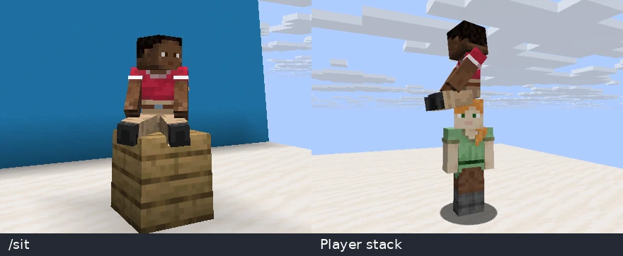
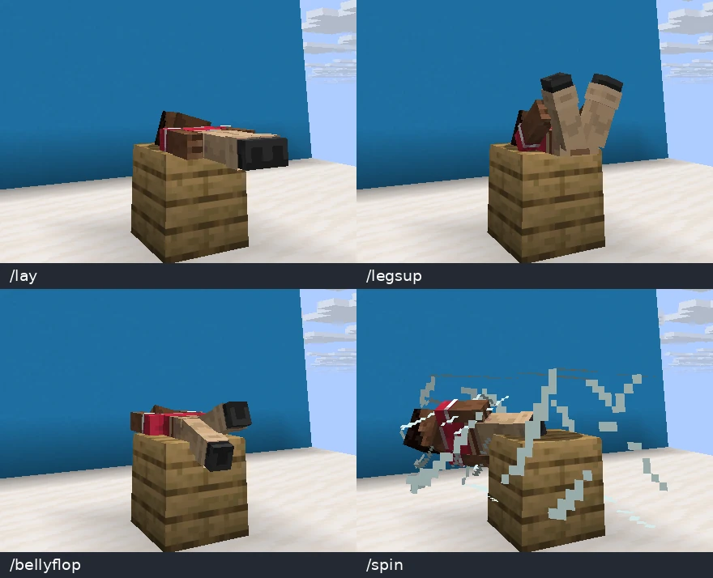
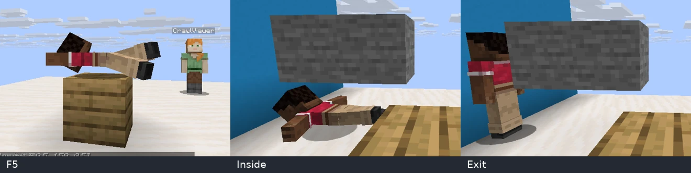

# Java 客户端验证

以下为项目独立前以插件名 `gsit` 完成的图形验收。截图、命令输出和 SHA-256 均对应当时使用的文件。现在复验时，将插件加载和卸载命令中的文件及元数据名分别改为 `pumpgsit.wasm`、`pumpgsit`，检查新建座椅时使用实体标签 `pumpgsit.seat.v1`。

2026 年 11 月 19 日在 Linux 的独立测试目录运行 Pumpkin `e318ec5ff87bbd0d72feafe40d6b24f230a8b84a`、GSit Wasm v0.2 和两个原版 Minecraft Java 26.3 客户端。两个客户端通过本机回环连接、分别在独立的 Xvfb 显示器上运行。红衣玩家 CrawlActor 使用简体中文，绿衣玩家 CrawlViewer 使用英语。以下图片均为实际游戏画面，经裁剪、拼图后保存。

四种静止姿势、右键操作和外部传送使用的 GSit 产物 SHA-256 为 `1ab5b4937360cff28b4d541dae0ffa58922f01e86eb00fa44ce706837be2b9e4`。一格高通道、首次起身坐标及双语提示先在 `483c43535135830e5bfc46d5fe116fb9db5b320b17aa6f668bf51a1f89ed06f1` 上记录。本节坐姿用默认配置。两个客户端均使用离线测试身份。

## 旧名移植版的发布件复核

正式交付的 GSit SHA-256 为 `f4dbc089b2da3b7813f90d54d01435788b620fbda647e80f9c03b81b1dda01ef`，配套 PumpkinPIE 为 `3e4d60653c2638d6053fd4c395c1a9ea348adee1f14e5e92f530ab10a7d0de6c`。两组件均取自 `dist/`，在同一隔离目录冷启动。

- 红衣玩家依次关闭右键坐方块和潜行爬行，绿衣玩家同时关闭参与叠坐。通过真实 PIE 调用逐项核对，红衣玩家的三项偏好为 `false / true / false`，绿衣玩家为 `true / false / true`。两人分别恢复开关后，读数恢复 `true / true / true`。
- 红衣玩家穿金头盔、钻石胸甲，主手拿金斧，执行 `/legsup`。绿衣玩家先离开 118 格，再回到原处切为创造模式。双方均看到有装备的翘腿形象。观察端未出现悬浮的第二套装备。在游戏内执行 `/gsitrl`，两端均显示站立的玩家和原装备。
- 红衣玩家旋转时，控制台执行 `plugin unload gsit`，效果消失、骑乘解除。重新装载实际文件后，红衣玩家又能仰卧，PIE 读到 `%gsit_posing%=true`。此时在控制台停服，日志显示所有插件卸载，世界与实体完成存盘。
- 重启并以两名原玩家登录。客户端显示站立的玩家和装备，`%gsit_posing%` 为 `false`。控制台执行 `execute unless entity @e[tag=gsit.pumpkin.seat.v1] run say clear` 返回 `clear`，`execute as CrawlActor on vehicle run say mounted` 没有发送消息。再次坐下则能查到载具，起身后仍可正常行走。第二次停服也完成存盘。
- 在仰卧期间停服，Pumpkin 在该玩家存档的 `RootVehicle` 保留了仅含 `Attach` 的 UUID。重启实测未恢复旧载具，场内没有残留的座椅。再次正常坐下、起身和保存后，宿主仍保留该字段。运行结果以骑乘关系和带标签实体查询为准。

## 坐下、起身与叠坐

1. 两人站在平地。让 CrawlActor 站在一个高出地面的完整木块上，执行 `/sit`。CrawlViewer 看到红衣玩家坐在木块上、双膝弯曲。控制台以 `execute as CrawlActor on vehicle run say mounted` 检查时，消息发送者为方块展示实体。
2. 坐下后按潜行键并松开。观察端看到玩家站起。默认配置下，本次木块位置使 Pumpkin 先把玩家安全放在相邻地面，首次移动再回到木块表面。一次实测的 Y 坐标依次是坐下时的 `149.425`、松开潜行键后静止时的 `149`、横移后的 `150`。重复坐下、起身后，玩家保持在线。
3. 将木块换成下半橡木台阶。执行 `/sit toggle off`，空手对准台阶顶面右击，玩家仍在原地站立。执行 `/sit toggle on` 并用相同视角再右击，玩家坐到台阶上，服务端能查到方块展示载具。
4. CrawlViewer 站在地上，执行 `/sit playertoggle off`。CrawlActor 空手右击其身体，未建立骑乘关系。CrawlViewer 再执行 `/sit playertoggle on`，重复右击，第三人称可见红衣玩家骑在绿衣玩家头顶。`execute as CrawlActor on vehicle run say mounted` 的发送者是 CrawlViewer。底部玩家按潜行键后，两人的骑乘关系解除。
5. 再次执行 `/sit`，由控制台执行 `tp CrawlActor -2.5 149 -2.5`。实测到达指定坐标，原载具解除。向前移动后位置约为 `(-2.28, 149, -1.23)`，两名玩家仍在线。

## 四种静止姿势

让 CrawlActor 在同一木块上分别执行下表命令。每次停留两秒以上，观察外观，再按潜行键起身、移一步，继续下一条。另用 F5 从角色本人背后重复这些动作，四种姿势均能看到自身身体。普通第一人称下，翘腿时双脚也会出现在画面前方。

| 命令 | CrawlViewer 实际看到的效果 |
| --- | --- |
| `/lay` | 玩家仰卧于木块表面，等待期间仍可见。 |
| `/legsup` | 身体仰卧，双腿向上举起。 |
| `/bellyflop` | 玩家俯卧，观察角度能区分头、躯干及伸出的肢体。 |
| `/spin` | 玩家在原处旋转，连续两帧可见不同的激流环。起身后环消失。 |

实测将观察者切换成旁观模式，传送到 118 格外，等待四秒，再传回原观察点。玩家仍在同一位置仰卧。原版旁观模式还能看到隐身本体的半透明轮廓，普通生存观察者仅看到仰卧形象。

## 爬行

- 在开阔地面执行 `/crawl`。本人 F5 和观察者均可看到横卧的爬行姿势。按前进键可以移动，按潜行键后恢复站立。附加的 PumpkinPIE 测试消费者读取到 `%gsit_crawling%` 随操作从 `false` 变为 `true`，离开后恢复 `false`。
- 在平地上方搭建两格长、一格净高的通道，正对通道，在入口半格内按潜行键。保持前进，从入口爬进去，再从另一端离开。实测人物在顶板下保持低姿态，离开顶板后自动站起，观察端同步显示。
- 下图第一格是红衣玩家本人的 F5 视角，后两格是绿衣玩家所见的通道内和出口状态。

## 语言和权限

| 操作 | 简体中文客户端 | 英语客户端 |
| --- | --- | --- |
| `/sit toggle off` | 已关闭右键方块坐下。 | Click-to-sit disabled. |
| `/sit toggle on` | 已开启右键方块坐下。 | Click-to-sit enabled. |

在控制台撤销 CrawlActor 的 OP 权限，再从该客户端执行 `/gsitrl`。Pumpkin 将管理命令从普通玩家的命令树隐藏，客户端实际显示“未知或不完整的命令”，并用 `gsitrl<--[此处]` 标出位置。此测试玩家仍可使用普通玩家的坐下和爬行命令。

## 配置重载、插件卸载与动作限制

以下在同一服务端进程中使用冷构建产物 `2306997dc38276b511ac907cd699dc46e2aa2cdd582f0a15596fbc22c1ba260d` 复现。每次切换后均从另一客户端观察。

| 操作 | 实测结果 |
| --- | --- |
| 让 OP 玩家仰卧，在游戏内执行 `/gsitrl` | 收到“GSit 配置已重新加载。”，本人及观察者均看到玩家站起。原座椅和骑乘关系清除。 |
| 旋转过程中由控制台执行 `plugin unload gsit` | 激流效果和分身消失，两端均看到站立的本体。未检出原带标签的展示实体。 |
| 同进程重新执行 `plugin load gsit.wasm` | 插件成功重新注册，现有两名玩家均能继续触发姿势，占位符重新解析。此宿主从运行目录读取动态装载的文件。在 Linux 测试目录使用了指向 `plugins/gsit.wasm` 的同名符号链接。普通启动从 `plugins/` 自动装载。 |
| 坐下时在控制台执行 `damage CrawlActor 1 minecraft:generic` | 默认配置下仍坐着。把 `get_up_damage` 改为 `true` 并重载后，再次坐下并造成相同伤害，玩家起身，骑乘和座椅都被清除。 |
| 开启 `crawl.double_sneak` 后执行 `/gsitrl`，站在开阔地低头，在 400 毫秒内按两次潜行 | 实测俯角 89°，开始爬行，观察端和 `%gsit_crawling%` 均确认。再按潜行恢复站立。 |
| 创造模式中，把 3 个苹果放在选中的快捷栏，仰卧后按 Q | 服务端检查该格仍有 3 个苹果。起身后以相同操作投掷，服务端余 2 个。 |

本记录覆盖 Java 26.3、默认皮肤和两人骑乘。基岩版、第三名玩家加入叠坐、联网账号自定义皮肤及跨版本客户端均未做实机验收。
