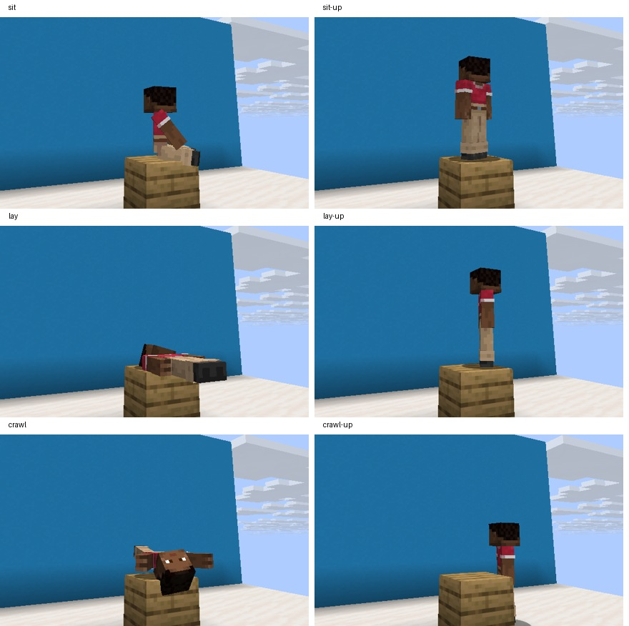
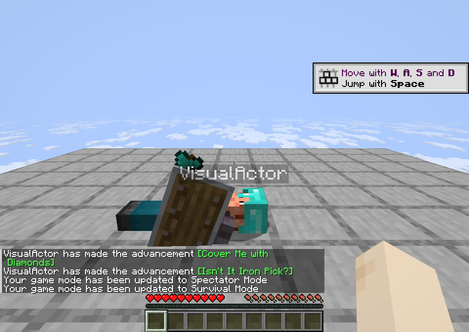
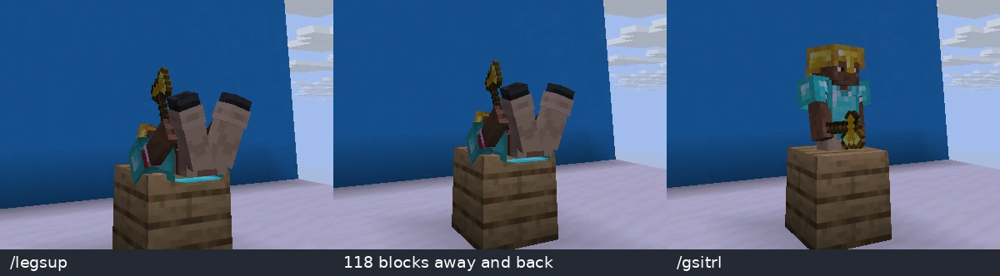

# 用两个 Java 客户端检查坐姿

准备两个原版 Java 26.3 客户端，找一块平地，让一个玩家做动作，另一个用生存模式站在侧面看。测试权限时只给执行管理命令的玩家 OP。截图可用来对照动作和界面。

## 坐姿、仰卧和爬行示例

两台原版 Java 26.3 客户端核对了方块坐姿、四种静止姿势、移动爬行和中英文偏好面板。测试使用离线账号。[验证范围](构建与验证.md#组件验收记录)

下图从上到下分别是 `/sit`、`/lay`、`/crawl`。左列是执行命令后的样子，右列是按潜行键起身后同一位玩家的样子。



## 坐下、叠坐和重连

| 怎么试 | 应该看到什么 |
| --- | --- |
| 空手对着下半台阶的顶面右击。再用 `/sit toggle off` 关掉右键坐下，起身后重试。 | 开启时能坐到台阶上，关闭后右击仍站着。用 `/sit toggle on` 恢复。 |
| 两人都开启 `/sit playertoggle on`，空手右击另一名玩家，让下面的人按潜行键。 | 先能看见一人坐在另一人头上。下方玩家潜行后，两人分开。 |
| 坐在台阶上断开连接，然后重新登录。 | 玩家站在台阶上，能正常走动。开启 `get_up_return` 后还可换一个较高的入座位置重试。 |
| 坐下后从控制台把玩家传送到另一处平地。 | 玩家到达新位置，可以行走，原来的座椅消失。 |


## 四种静止姿势

依次执行 `/lay`、`/legsup`、`/bellyflop`、`/spin`，每次保持至少两秒再起身。应能分别看到仰卧、仰卧抬腿、面朝下趴着、原地旋转和激流粒子。按 F5 还可从本人视角查看。


给做动作的人戴上头盔、拿一件武器。让观察者走出模拟距离，在此期间换装备，等观察者回来再起身。返回时应能看到换好装备的姿势模型，起身后装备只显示在站着的玩家身上。需要排查模型重影时，记下两人的游戏模式和观察距离。[模型和装备的检查方法](姿势.md)

测试时，观察者离开了 128 格。玩家保持仰卧，把金胸甲和铁镐换成下界合金胸甲和钻石斧。下图是观察者回到 3 格处时看到的画面。随后玩家潜行起身，装备回到站立的人物身上，原座椅和姿势辅助实体都已清除。



## 爬行和手势

在平地输入 `/crawl` 并向前走，观察者应看到玩家贴地移动。默认按潜行键退出。再搭一段两格长、一格净高的通道，面向入口按潜行并往前走。进入后保持爬姿，出了顶板就会站起。若关闭过手势，先输入 `/crawl toggle on`。双击潜行需要另开 `crawl.double_sneak`。[爬行配置](使用与配置.md)


## Pumpkin 互动偏好面板

在简体中文客户端和英语客户端分别输入 `/gsitprefs`，点击「右键方块坐下」这一行，再次打开面板。两人应各自收到所选语言的提示，自己的第一行改变，另外两行保持原值。撤销 `PumpGsit:sittoggle` 后，玩家仍能看见第一行，但点击不会切换。撤销共用权限 `PumpGsit:command` 后，三行都只能查看。[面板截图](images/pumpkin-preferences.png) · [权限与双语测试](../tests/support/disconnect.rs)

## 重载与卸载

在独立测试服里让一人仰卧，由 OP 执行 `/pumpgsitreload`。双方应看到玩家站起、装备恢复。再让玩家旋转，从控制台执行 `plugin unload PumpGsit`，确认激流粒子和座椅消失。重新加载组件后，同一名玩家应能再次坐下。需要查看是否还留有座椅时，可在所有人都已起身后运行：

```text
execute unless entity @e[tag=pumpgsit.seat.v1] run say clear
```



## 待复查

基岩版、跨版本客户端、三人叠坐和联网皮肤都还缺实机画面。复查皮肤时可用带披风的联网账号做一次仰卧，比较本人、旁观者和起身后的外观。
