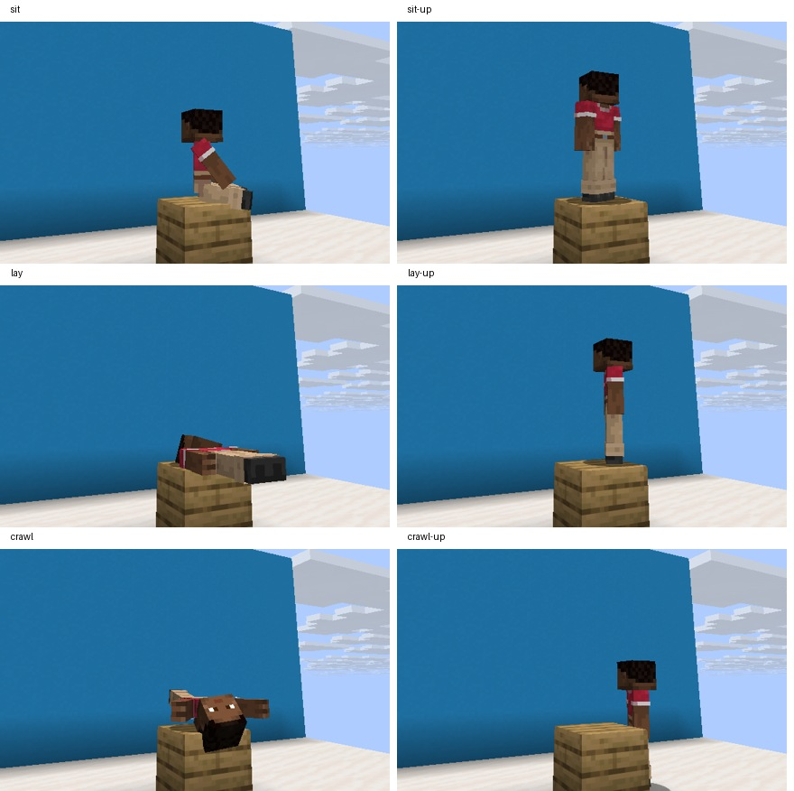

# 构建、功能对照与验证记录

## 目标版本

| 项目 | 本次使用的版本 |
| --- | --- |
| 原插件 | Gecolay/GSit 3.8.0，提交 `04b792026acf95b63f198691d85218a1023e2f92`，Bukkit/Paper 服务端插件 |
| 原平台对照 | Paper 26.3 build 249，提交 `1a995d6`，加载原版插件验证静态姿势 |
| 目标服务端 | Pumpkin `0.2.2+26.3-26.63`，提交 `e318ec5ff87bbd0d72feafe40d6b24f230a8b84a`，Linux x86_64。独立测试服二进制 SHA-256 为 `78433325e917bad632bede86e79b5da255312842547b277cd326711076f105de` |
| PumpGsit 组件 | 0.1.2，目标 `wasm32-wasip3`，插件世界 `pumpkin:plugin@0.2.0`。用 `wit-bindgen 0.63.0` 从宿主同一提交的 47 个 WIT 文件生成异步绑定 |
| 客户端 | Java 26.3（协议 777）。v0.1.2 使用两个原版图形客户端复查坐下、仰卧、爬行和重载权限。迁移阶段的完整图形记录对应 `wasm32-wasip2` 组件 |
| 构建工具 | Rust/Cargo 1.100.0，WASI SDK 34.0（clang 23.1.0），wasm-tools 1.263.0。宿主锁定 Wasmtime 50.0.1 |
| 占位符联调环境 | 单独安装与目标宿主兼容的 PumpkinPIE 0.2.6，支持六个占位符 |

目标提交的 Native API 版本常量为 6，Rust SDK 的默认生成路径是 `v0.1`。服务端通过 `plugin-v0_2` 构建特性启用异步 0.2 宿主。准备阶段从官方示例提交 `3c9305cf394e410d6bd1927154f5b731b6c1d3dc` 原样构建 Hello World；旧 SDK 生成的组件在此宿主加载时报告 `type-checking export func handle-event`。在迁入 GSit 代码之前，用同一个 Hello World 的加载、数据目录访问和卸载操作验证了 0.2 绑定，日志依次出现欢迎语、`Loaded hello-world-v02`、告别语和正常停服。绑定与服务端提交一起锁定，更新宿主时需重新比对接口。[宿主构建特性](https://github.com/Pumpkin-MC/Pumpkin/blob/e318ec5ff87bbd0d72feafe40d6b24f230a8b84a/crates/pumpkin/Cargo.toml) · [目标 WIT](https://github.com/Pumpkin-MC/Pumpkin/tree/e318ec5ff87bbd0d72feafe40d6b24f230a8b84a/crates/pumpkin-plugin-wit/v0.2) · [官方示例](https://github.com/Pumpkin-MC/pumpkin-plugin-examples/tree/3c9305cf394e410d6bd1927154f5b731b6c1d3dc)

## 从源码构建

先在指定提交的 Pumpkin 源码目录构建服务端。

```sh
cargo build --locked --release -p pumpkin --features plugin-v0_2
```

以下命令在 PumpGsit 项目目录中执行。仓库的 Cargo 配置将默认目标设为 `wasm32-wasip3`。该目标从 Rust 1.100.0 开始在稳定版提供，要求宿主支持 WASI 0.3 和异步组件模型。使用 wasm-tools 1.263.0，并将 WASI SDK 34.0 解压到本机。把下文的 `/opt/wasi-sdk` 换成该 SDK 的安装目录，Cargo 会使用其中的 C 编译器、头文件和归档工具编译捆绑的 SQLite。[Cargo 目标配置](../.cargo/config.toml) · [Rust 官方目标说明](https://doc.rust-lang.org/rustc/platform-support/wasm32-wasip3.html)

```sh
export RUSTUP_TOOLCHAIN=1.100.0
rustup toolchain install "$RUSTUP_TOOLCHAIN" --profile minimal --component rustfmt,clippy --target wasm32-wasip3
export WASI_SDK_PATH=/opt/wasi-sdk
export WASI_SYSROOT="$WASI_SDK_PATH/share/wasi-sysroot"
export CC_wasm32_wasip3="$WASI_SDK_PATH/bin/wasm32-wasip3-clang"
export AR_wasm32_wasip3="$WASI_SDK_PATH/bin/llvm-ar"
bash .github/scripts/build.sh
(cd target/release-assets && sha256sum -c SHA256SUMS)
```

该脚本检查格式、Clippy 和 Wasm 接口，并打包当前源码的产物。可安装文件为 `target/release-assets/PumpGsit.wasm`，其校验文件在同一目录。[安装](../README.md) · [Pumpkin 官方开发文档](https://docs.pumpkinmc.org/plugin-dev/introduction) · [Bukkit 迁移指南](https://docs.pumpkinmc.org/plugin-dev/migrating-from-bukkit/) · [Pumpkin Plugin Knowledge Base](https://book.vypal.me/)

## GitHub Actions 与版本发布

主分支推送和 pull request 会运行格式检查、面向 `wasm32-wasip3` 的 Clippy、锁定依赖的 Release 构建和组件校验。工作流固定使用 Rust 1.100.0、WASI SDK 34.0、wasm-tools 1.263.0。编译器和 WASI SDK 有差异时，本地结果的 SHA-256 也可能不同。部署时以所选 Release 随附的校验文件为准。[构建工作流](../.github/workflows/build.yml)

| 渠道 | 触发方式 | 如何识别产物 |
| --- | --- | --- |
| 正式版 | 项目维护者在要发布的提交上推送 `v主.次.补丁` 标签，如 `v0.1.2`。版本须与该提交中 `Cargo.toml` 的包版本相同。 | 在 GitHub Releases 中标记为正式版。最新正式版可用固定下载入口。 |
| 每夜构建 | 北京时间每日 02:17（UTC 18:17）计划运行，也可以在默认分支上手动运行发布工作流。 | 以 `nightly-YYYY-MM-DD-<提交前12位>` 标记为预发布版，每个日期和源码提交均可追溯。 |

两种发布的附件均为 `PumpGsit.wasm` 和 `SHA256SUMS`。校验文件只记录该组件的 SHA-256。在 Actions 的发布工作流页面可找到每次运行的提交、构建日志及结果。[发布工作流](../.github/workflows/release.yml) · [正式版](https://github.com/Q2297045667/PumpGsit/releases/latest) · [每夜发布](https://github.com/Q2297045667/PumpGsit/releases?q=nightly)

## 功能对照

下表的玩家操作记录来自从 Bukkit 迁往 Pumpkin 时对 `wasm32-wasip2` 组件的验收。更名前的组件摘要及截图保存在本页末尾和客户端记录中。

| 原版操作 | Pumpkin 实现与验收 |
| --- | --- |
| 方块坐下、潜行起身 | `/sit` 或点击允许的方块顶面，使用原生方块碰撞形状、真实载具和乘客关系。双客户端验证坐姿、下半台阶、偏好拒绝、潜行与外部传送。 |
| 玩家叠坐 | 点击者与顶层玩家各自同意后，通过原生乘客 API 叠坐。双客户端验证关闭/开启偏好、载具身份、底部潜行解除。三人以上与自定义层数未做图形验收。 |
| 仰卧、翘腿、俯卧、旋转 | 共享座椅负责实际位置。按观察者发送 Java 26.3 模型、姿势与装备数据。每种动作都在两台图形客户端确认，复测包含保持姿势、起身与观察者离开再返回。[姿势验证](姿势.md) |
| 可移动爬行 | 服务端游泳标记控制碰撞，私有辅助实体控制 Java 客户端预测。实测开放地面能移动，面对一格高的通道可潜行进入并在出口站起。[游戏画面](客户端验证.md) |
| 权限、命令及双语提示 | Brigadier 注册七个原命令及别名；权限树同时检查玩法、管理和绕过节点。测试控制台、未知离线姓名、无管理权限、配置错误和两种客户端语言。[命令清单](使用与配置.md) |
| SQLite 玩家偏好 | 直接读写原版三张表，接受原 UUID 和原来的默认值语义。旧代码生成样本、Wasm 修改、重新启动、旧代码再读、快照恢复均已执行。[切换与回滚](存储.md) |
| 占位符 | 向选定的 PumpkinPIE 注册六个原名。通过真实提供方和消费组件分别核对玩家状态、偏好和离线目标。缺少 PIE 时，PumpGsit 可以独立启动并处理玩家操作。[PIE 验收](占位符.md) |

## 已知差异与部署范围

- 起身时 Pumpkin 首先选择安全下车位置。设置返点时，玩家随后的第一步有效位移触发校正。骑乘中被 `/tp` 传送会保留外部传送的目的地。已坐下时要换到另一个座位，请先起身。
- 右键方块事件提供玩家、方块坐标和动作。插件根据视线推算顶面和命中点，并检查主手物品。仅副手触发的包和方块碰撞极限位置可能与 Bukkit 的原始手别、点击面有差异。
- 原版随活塞移动方块座椅。目标 WIT 的活塞事件只给出活塞坐标和朝向，缺少世界及实际移动方块清单。本版座椅留在原位置；开启 `get_up_break` 时，检测到原支撑变成空气会使玩家起身。应在固定方块上布置座椅。
- 主分支用宿主 Brigadier 固定参数提供补全。原版 YAML 语言文件可复制到插件数据目录。权限需按本服的 Pumpkin 权限规则配置。离线目标可直接填旧库的 UUID。宿主拒绝的命令语法和无权查看的命令使用 Minecraft 客户端自己的错误消息。
- 本次只接入用户选定的占位符提供方。旧服的 WorldGuard、GriefPrevention、PlotSquared 区域规则和 `trusted-region-only` 不参与判定；服务器可用世界黑白名单限制玩法。NPC 叠坐、Bukkit 自定义事件/Java 插件 API、非官方 FeatureFlags、原版更新通知和统计上报均未迁移。需要跟踪更新时可按上述提交与校验文件管理版本。
- 发布范围是 Java 26.3。基岩版、其他 Java 协议、在线皮肤披风及肩上鹦鹉等细节见[姿势差异](姿势.md)。目前只验证 Linux x86_64 宿主。玩家数据库使用单个进程独占的 SQLite，MySQL、多服共享写入、其他 OS 宿主未验证。

主分支修复的命令、坐姿、语言、断线坐标和旧库往返实测见[兼容性审计](原版兼容性审计.md#主分支修复验证)。后面的版本记录对应各自标签。

## 重跑验证

以下脚本只使用传入的文件，在临时目录准备世界、回环端口、权限和测试样本。请将服务端路径替换为上述构建的可执行文件。运行第二项占位符联调时，另行提供兼容当前宿主的提供方文件。

```sh
python3 tests/server_smoke.py /path/to/pumpkin target/release-assets/PumpGsit.wasm
python3 tests/pie_smoke.py --server /path/to/pumpkin \
  --component target/release-assets/PumpGsit.wasm --pie /path/to/compatible-provider.wasm
```

测试含 WAL 的旧库与实际 Paper 回滚可另行运行以下命令。`--paper-cache` 指定已有的 Paper 测试安装，用于复制该安装接受过的 EULA、缓存和依赖；测试另外建立服务端目录和世界。

```sh
python3 tests/disconnect_smoke.py /path/to/pumpkin target/release-assets/PumpGsit.wasm
python3 tests/sqlite_compat.py /path/to/pumpkin target/release-assets/PumpGsit.wasm
python3 tests/paper_roundtrip.py --java /path/to/jdk25/bin/java \
  --paper /path/to/paper-26.3-249.jar --paper-cache /path/to/paper-test \
  --gsit /path/to/GSit-3.8.0.jar --server /path/to/pumpkin \
  --component target/release-assets/PumpGsit.wasm --pie /path/to/compatible-provider.wasm
```

要使用每夜发布附件运行上述测试，可先将环境变量 `PUMPGSIT_BUILD_VERSION` 设置为该每夜版的完整版本号（例如 `0.1.2-nightly.20261119+abcdef123456`）。正式版默认使用 Cargo.toml 中的版本。

第一项依次检查全新安装、仅限玩家的命令、帮助和别名、插件卸载/加载、重复写同一偏好、配置失败留用旧值、中英文控制台输出和原库重启。第二项用真实提供方验证占位符注册、卸载后再次加载、不同加载顺序与停服。图形验收步骤、原库演练数据与逐项结果分别保存在上表链接的文档中。

### 主分支修复构建

2026-11-20，在独立源码和空构建目录中使用 Rust 1.100.0、WASI SDK 34.0、wasm-tools 1.263.0、锁定的 wit-bindgen 0.63.0 和随仓的 Pumpkin Wasm 0.2 WIT。目标为 `wasm32-wasip3`。格式检查、Clippy、Release 编译和组件 ABI 校验通过。本地验收组件 SHA-256 为 `ce9aae1598acc9b31745535cfdd832c78f20acd35d42adb9bb5be4b7097ac29c`。两项基础实服测试、SQLite 变体和真实 Paper 读写回滚均通过。[修复验证](原版兼容性审计.md#主分支修复验证)

### v0.1.2 的升级与游戏验收

本次以 GitHub 的 v0.1.1 成品建立旧数据，经过停服迁移和改名，PumpGsit v0.1.2 能继续读取中文 TOML 和玩家偏好。修改偏好后重启读回，并携带最新库回滚到 v0.1.1，旧版本也读到了修改后的值。[升级与回滚实测](存储.md)

两个原版 Java 26.3 客户端分别使用简体中文和英语。对方能看到 `/sit` 的屈膝坐姿、`/lay` 的仰卧和 `/crawl` 的爬姿，每项退出后都恢复站立。普通玩家输入 `/pumpgsitreload` 得到未知命令提示，授予 OP 后相同玩家输入同一命令收到“PumpGsit 配置已重新加载。”。下文保留 v0.1.1 和更早组件的独立测试记录及截图。

### v0.1.1 的 WASI 0.3 验证（wasm32-wasip3）

2026-11-19，使用上文的锁定版本通过格式检查、目标平台 Clippy、Release 构建和组件校验。本地验收的 `pumpgsit.wasm` SHA-256 为 `5c2a9147ec83a5011f7f37a643a55aaa4409ebfdb13a7d1330624f7280e8d7e6`。组件导入 `wasi:filesystem/types@0.3.0`，并继续导出 `pumpkin:plugin/metadata@0.2.0` 和 `pumpkin:plugin/gametest-callbacks@0.2.0`。

在该宿主上，WASI 0.3 的加载、命令和定时回调各有自己的任务局部存储。v0.1.1 将配置、玩家偏好缓存和活动姿势保存在插件实例中，使后续回调能读取加载时建立的状态。

在独立 Pumpkin 上，两套仓库测试均通过。基础测试覆盖全新安装、命令别名、控制台执行仅限玩家的命令、英中提示、插件卸载与加载、错误配置回退和数据库重启。占位符测试按两种顺序加载 pumpgsit 与另装的 PumpkinPIE，六个原名在热重载和重启后均可解析。两组测试的宿主日志均未出现 Wasm 回调陷阱。

用 GSit 3.8.0 原代码生成两名玩家的 SQLite 偏好后，Pumpkin 修改了两人的点击坐下开关。重启 Pumpkin、再用新 JVM 运行原版服务类，均读到了预期值。三张表的完整性检查通过。[逐项结果](存储.md)

用 Java 26.3 协议客户端执行 `/sit` 两次，第二次确认原座椅的乘客列表已清空。仰卧期间，旁观者在姿势开始后加入，离开显示范围再返回时，看到的虚拟玩家 UUID 相同。旁观端收到模型的主手、头盔、挥手和受伤数据，起身后装备重新显示在真实玩家身上。执行 `/crawl` 两次，旁观端先收到游泳标记为真、姿势为 3 的数据，结束时收到游泳标记为假、姿势为 0 的数据。

两台原版 Java 26.3 客户端一起登录，中文客户端依次执行 `/sit`、`/lay`、`/crawl`。英文客户端在旁观察到屈膝坐姿、仰卧和低身爬姿。每项按潜行键退出后都恢复直立，随后服务端正常关闭。下图左列为各命令生效后的画面，右列为同一玩家起身后的画面。



### 独立仓库更名验证（wasm32-wasip2）

2026-11-19，两套脚本使用本地重新构建的 `pumpgsit.wasm` 在真实 Pumpkin 上运行通过。其 SHA-256 为 `37222113803c55011d0c0791e7c9d4c565465d1e32d9b73a804c112c79c4ebca`。服务端从 `plugins/data/pumpgsit/` 读写数据，新主命令和旧别名均可用，GSit 3.8.0 的 SQLite 样本能在修改、重启后继续读取。两种加载顺序下，PumpkinPIE 均显示 `%gsit%  from pumpgsit` 并解析六个原占位符。

### 更名前的组件验证（wasm32-wasip2）

2026-11-19 将锁文件、源码、WIT、语言资源和默认 TOML 复制到新目录，从空的 Cargo 构建目录以 `--offline --locked --release --target wasm32-wasip2` 生成交付件。文件 `gsit.wasm` 的 SHA-256 为 `f4dbc089b2da3b7813f90d54d01435788b620fbda647e80f9c03b81b1dda01ef`。WIT 与目标提交逐文件一致。格式检查、目标平台 Clippy 严格检查、两个组件的 `wasm-tools validate`、安装包校验和、项目内文档链接及两套语言资源的 23 个键均已核对通过。

使用这个 GSit 文件运行上面的两项测试，占位符联调另行加载兼容的提供方。全新安装和原库正常启停，重载错误配置时保留旧设置，原 SQLite 表完整性为 `ok`。两种加载顺序下占位符都恢复解析，连续卸载和加载后均能正常保存并退出。游戏画面记录给出了各轮使用的产物摘要，以便区分已修复问题和当前结果。[客户端验证](客户端验证.md)
